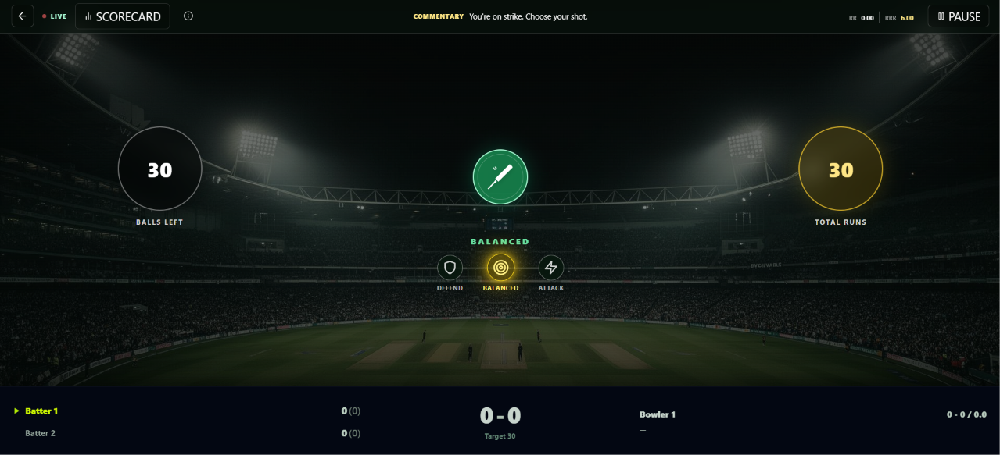
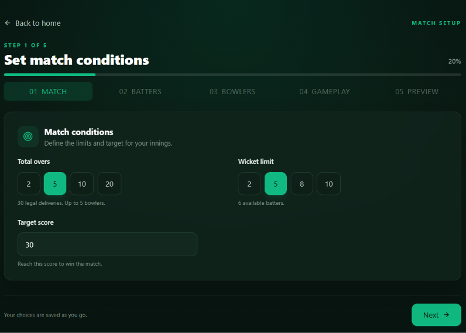
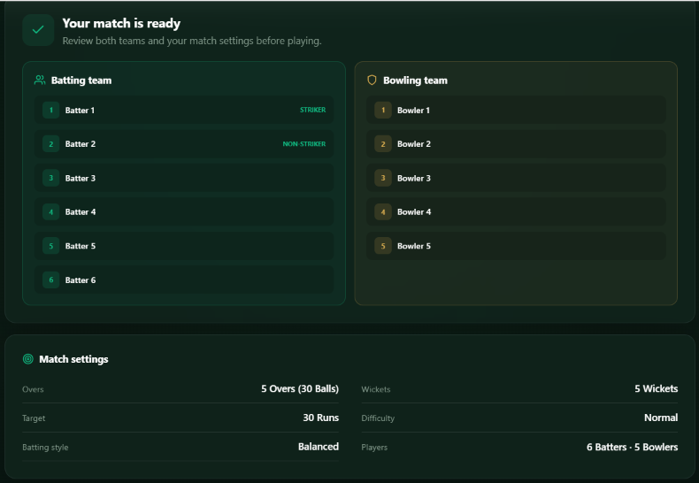

<div align="center">

# 🏏 SCricket

### Your Cricket. Your Match. Your Rules.

A modern, interactive cricket game where you can customize your match, choose your players, set your gameplay preferences, and experience cricket your way.

<br/>


<br/>

**[Explore Repository](https://github.com/saqlainhub/SCricket)**

</div>

---

## 🎮 About SCricket

SCricket is a browser-based cricket game designed to bring a customizable cricket experience to your screen.

Instead of playing with fixed settings, you can configure your own match, select your batting and bowling lineups, adjust gameplay preferences, and take control of the match.

Whether you want a quick match or a customized cricket challenge, SCricket gives you the flexibility to play your way.

## ✨ Features

- 🏟️ **Immersive Game Interface** — A cricket-inspired stadium experience.
- ⚙️ **Custom Match Setup** — Configure overs, wickets, and target score.
- 👥 **Custom Player Names** — Personalize batting and bowling lineups.
- 🎯 **Gameplay Settings** — Choose difficulty and batting style.
- 🏏 **Interactive Gameplay** — Play and control match actions.
- 📊 **Live Match Scoreboard** — Follow your match progress.
- 🔄 **Replay Matches** — Start another match with your preferred settings.
- 📱 **Responsive Design** — Optimized for desktop and mobile screens.


## 🖥️ Screenshots

<div align="center">

| Home Screen | Gameplay |
|:---:|:---:|
|  |  |

| Settings | Setup & Preview |
|:---:|:---:|
|  |  |

</div>


## 🛠️ Tech Stack

| Technology | Purpose |
|---|---|
| React | User interface |
| Vite | Development server and build tool |
| JavaScript | Game logic and interactivity |
| Tailwind CSS / Utility Classes | Styling and responsive layouts |
| React Icons | Interface icons |

## 🚀 Getting Started

Follow these steps to run & play SCricket.

### 1. Open in Browser

```bash
https://scricket.vercel.app
```

### 2. Install in Phone

- Click on three dots in browser
- Select Install or Shortcut to install on phone as app.

## 🎯 Project Goals

SCricket aims to provide:

- A simple and enjoyable cricket gaming experience.
- Flexible match customization.
- An intuitive and interactive interface.
- A responsive experience across different screen sizes.
- A foundation for future gameplay improvements.

## 🔮 Future Improvements

Some ideas for future development:

- More advanced batting and bowling mechanics.
- Additional match formats.
- Enhanced player statistics.
- Match history and saved results.
- Sound effects and stadium atmosphere.
- Multiplayer functionality.

## 👨‍💻 Developer

**Saqlain Ahmad**

Full Stack Software Engineer & AI Engineer

- GitHub: [@saqlainhub](https://github.com/saqlainhub)

---

<div align="center">

### 🏏 Thanks for checking out SCricket!

If you like this project, consider giving it a ⭐ on GitHub.

**Built with passion for cricket and code.**

</div>
